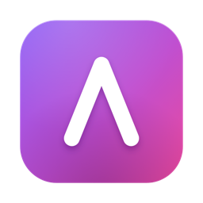
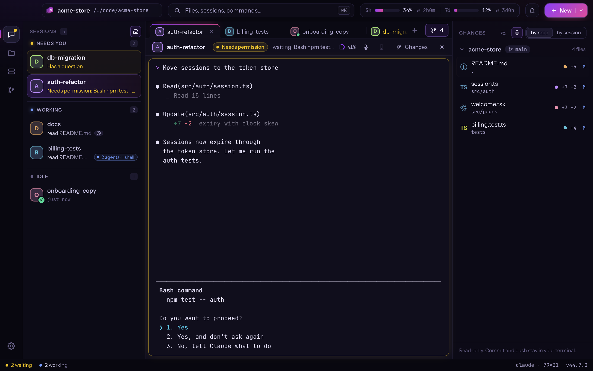
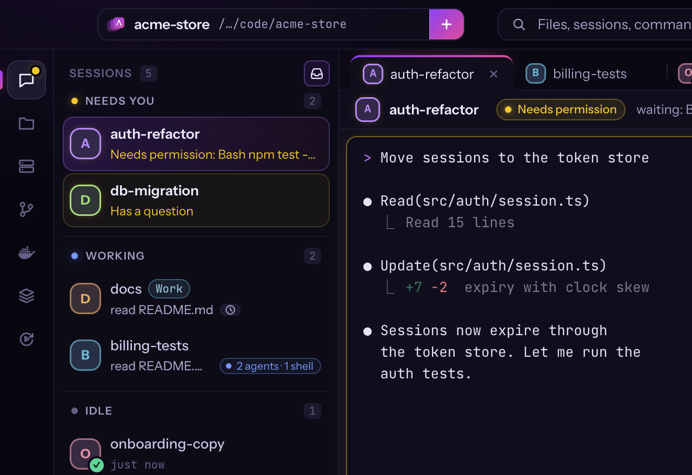
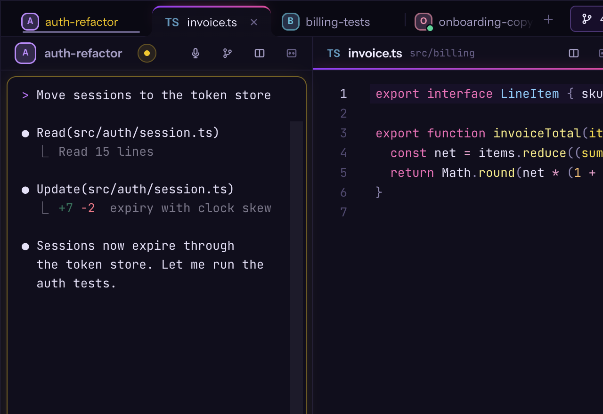
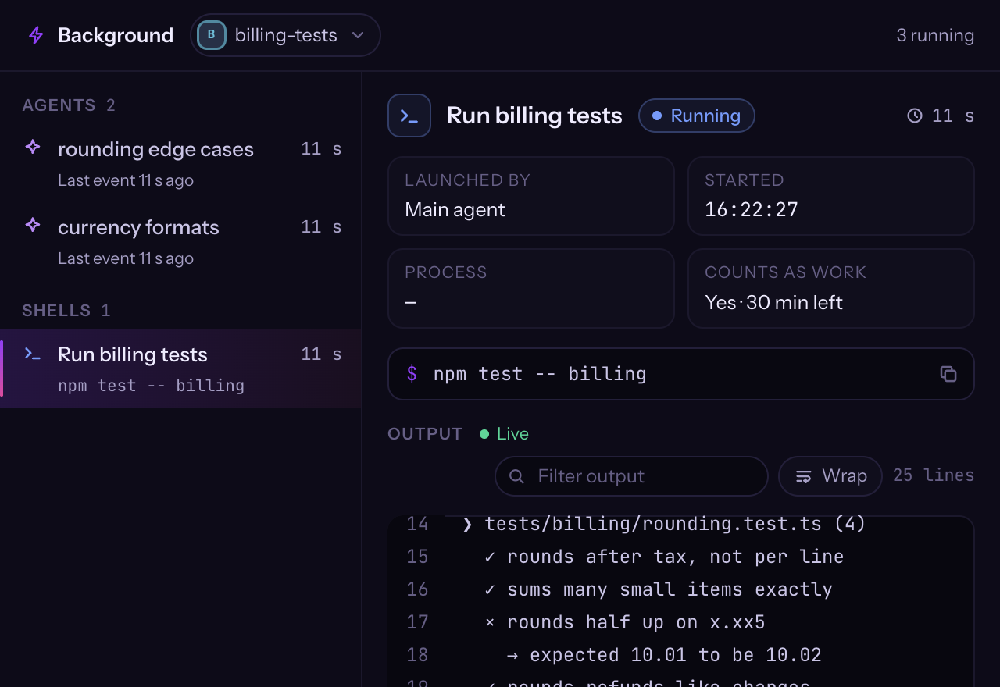
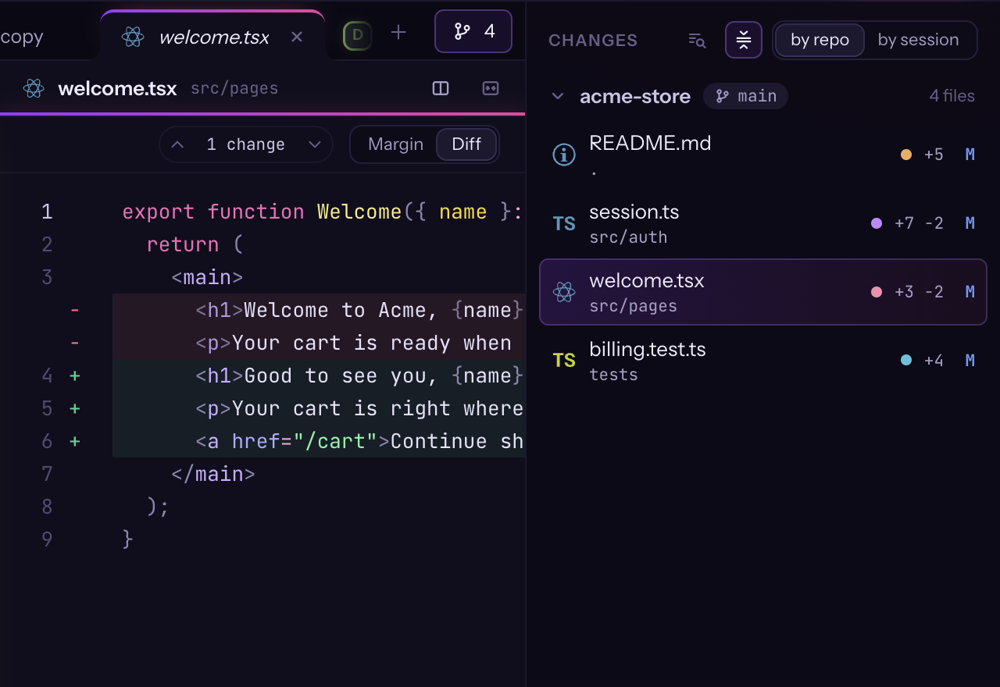
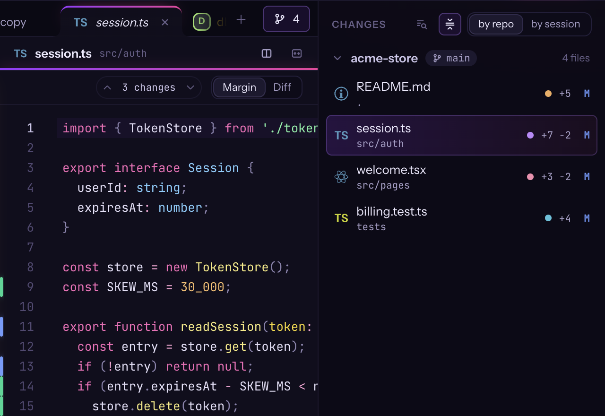
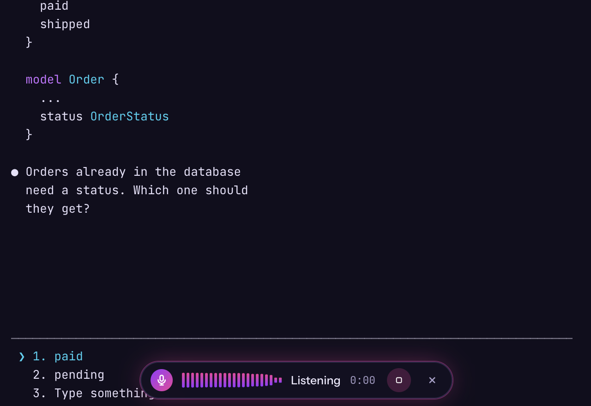
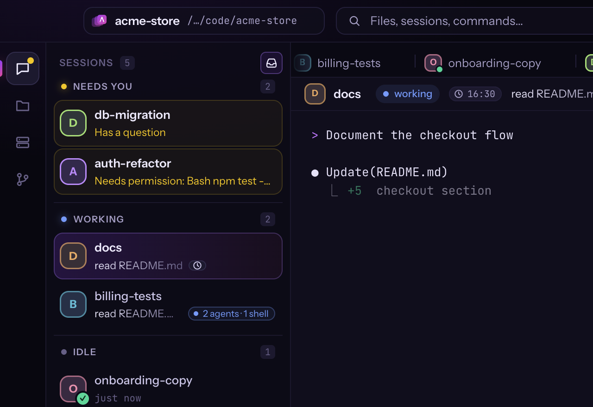

# Atelier

**Many Claude Code sessions, never lose track.**

A Mac app for running Claude Code sessions in parallel: live states, one key to the session waiting for you, every
change traced to the session that made it.

[**Download for macOS**](https://useatelier.dev/download) · [Website](https://useatelier.dev) ·
[What's new](https://useatelier.dev/changelog) · [All releases](https://github.com/frmusso/atelier-releases/releases) ·
[Support Atelier](https://useatelier.dev/support)

## Why Atelier

- **The real `claude` CLI.** Not a wrapper: your Claude Code, its status line, its commands, in real terminals.
- **Sessions that stay alive.** Quit, update, restart: your sessions keep going.
- **Keyboard first.** Every action a shortcut away. ⌘K finds the rest.

This repository hosts the releases (DMG and update files) and this page; there is no source code here.

## Features

### Know who needs you

Every session shows what it is doing. When one needs you, you know — and ⌘J takes you there.

- Needs permission, has a question, working, done, failed
- Notification center, Dock menu and banners
- Background agents and shells, context, limits and cost

### Everything side by side

Sessions, terminals and files are tabs. Put up to three side by side and keep your hands on the keyboard.

- Split view with up to three panes (⌘\\)
- Command palette (⌘K) for files, sessions and commands
- Context menus everywhere

### See what runs in the background

Click a session's chip to see its agents, shells and monitors. Open one beside the session and watch it live.

- Live output of background shells and monitors
- Each subagent's steps as it takes them
- Scheduled wake-ups with a countdown

### See who changed what

Every changed file carries the colour of the session that touched it — down to the exact command.

- Changes by session or by repository
- Review with line comments sent back to Claude
- Source Control history graph, pull request and CI chips

### A real editor next to Claude

Open, edit and save files without leaving the session. When Claude edits the same file, nothing gets lost.

- Fast editor with find, comments and syntax colours
- Compare, keep yours or reload when Claude changes a file
- ⌘L mentions the selected lines in the session

### Talk to Claude

Hold ⌥Space and speak. Transcription runs on your Mac, so your voice never leaves it.

- On-device transcription with whisper.cpp on Metal
- Optional clean-up of the text by Claude Haiku (the text, never the audio)
- Off until you turn it on

### Close the app. Your sessions keep going.

A background service owns your terminals. Quit Atelier, install an update or restart your Mac: pick up where you left
off.

- Sessions keep running when the window closes
- Updates install on restart without closing sessions
- Resume past conversations from the sidebar (⌘⇧N)

### And more

| | |
|---|---|
| **Atelier terminal** | A fast zsh with command blocks and output triggers. |
| **Ports, one click away** | Servers started in a terminal show their port; click to open. |
| **Service logs** | Your project's tmux panes, read-only, next to the sessions. |
| **Tasks become sessions** | Connectors bring your tasks in — ClickUp first, more to come. |
| **Session panel** | Model, permission mode, MCP servers and skills at a glance. |
| **Names in step** | Rename a session in Atelier and Claude's `/resume` follows. |
| **Make it yours** | Appearance, terminal, editor and notifications; every shortcut listed. |
| **Calm by design** | Reduce motion, swap the side panels, zoom the interface. |

### Keys to remember

| Keys | |
|---|---|
| <kbd>⌘</kbd> <kbd>J</kbd> | Next session waiting |
| <kbd>⌘</kbd> <kbd>K</kbd> | Command palette |
| <kbd>⌘</kbd> <kbd>\\</kbd> | Split view |
| <kbd>⌥</kbd> <kbd>Space</kbd> | Dictate |
| <kbd>⌘</kbd> <kbd>L</kbd> | Mention lines |
| <kbd>⌘</kbd> <kbd>N</kbd> | New session |

## Install

**Requirements:** a Mac with Apple Silicon (M1 or later), macOS 13 Ventura or later, and
[Claude Code](https://docs.anthropic.com/en/docs/claude-code) installed and signed in (`claude` works in Terminal).

1. Download the DMG from [useatelier.dev/download](https://useatelier.dev/download) or from the newest
   [release](https://github.com/frmusso/atelier-releases/releases) (`Atelier-<version>-arm64.dmg`).
2. Open it and drag **Atelier** onto **Applications**.
3. Open Atelier from Applications. It is signed with a Developer ID and notarized by Apple: macOS only asks once
   whether to open an app downloaded from the internet.
4. Open a project folder and start a Claude session with ⌘N. Atelier asks for the microphone only if you turn on
   dictation (Settings › Dictation).

## Updates

Atelier keeps itself up to date. It checks shortly after launch and every 6 hours (or now: **Atelier › Check for
Updates…**), downloads the new version in the background and verifies it — Atelier's release signature and Apple's
code signature — before anything is installed. When it is ready, the footer shows **Update ready · Restart**: restart
whenever you like, your sessions keep running.

Choose the channel in **Settings › About**: **Stable** (tested releases), **Beta** (new features first, and every stable
release), **Auto** (the channel of the version you downloaded) or **Off**.

Rarely, a version needs Atelier's background service restarted; then Atelier does not install it on its own: Settings ›
About explains it and links the release page. Updates also need Atelier in the Applications folder, not in Downloads or
a disk image.

Going back to the previous version

After an update, the version you had is kept for a while as a hidden `.Atelier-previous.app` next to
`/Applications/Atelier.app`; Atelier deletes it the second time the new version starts. Until then:

1. Quit Atelier.
2. In Terminal:
   `mv /Applications/Atelier.app ~/.Trash/Atelier-new.app && mv /Applications/.Atelier-previous.app /Applications/Atelier.app`
3. Open Atelier and set the channel to **Off** in Settings › About, otherwise it updates again.

Later, install an older version from its DMG on the [releases](https://github.com/frmusso/atelier-releases/releases)
page.

## Privacy

- No account, and no analytics in the app.
- Atelier checks for updates at `useatelier.dev`; your projects, sessions and files stay on your Mac.
- Dictation is transcribed on your Mac. The optional clean-up sends the text, never the audio, to Claude Haiku through
  your own Claude Code.
- Connectors (ClickUp) talk to their service only after you connect them; their tokens are encrypted in the Keychain.

## Feedback and problems

Write to **[hello@useatelier.dev](mailto:hello@useatelier.dev)** with the Atelier version and channel (Settings ›
About), your macOS version, and what happened. For crashes and update problems, the log helps:
`~/Library/Application Support/Atelier/logs/app.log` (it can contain your projects' paths: have a look before sharing
it).

## Uninstall

Quit Atelier and close the sessions you still have running, move `/Applications/Atelier.app` to the Trash and, to
remove its data too, the folder `~/Library/Application Support/Atelier`.

---

Free · Made by Francesco Musso · [useatelier.dev](https://useatelier.dev) · [Support Atelier](https://useatelier.dev/support)

Atelier is an independent project, not affiliated with Anthropic. Claude and Claude Code are trademarks of Anthropic.

